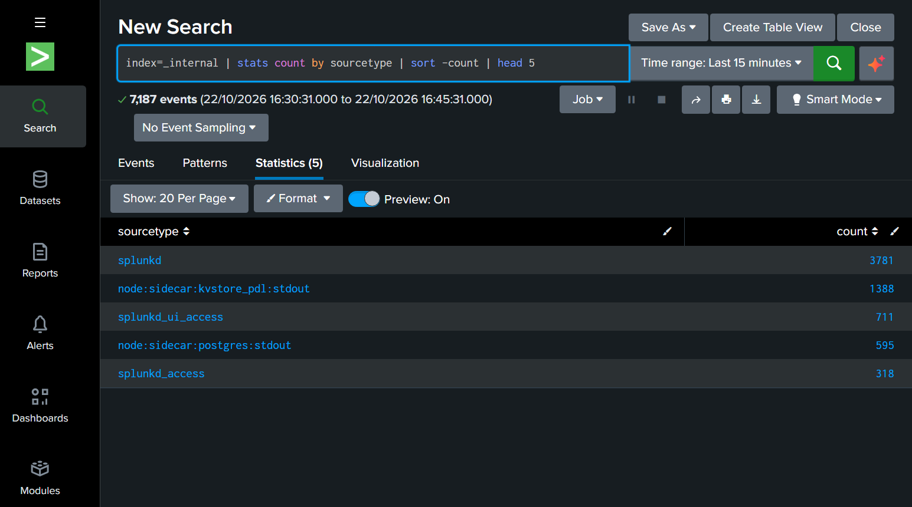

# Lab 01 — First SPL Search: Getting to Know Splunk's Data

**Module:** 1 — Fundamentals · **Level:** Beginner · **Estimated time:** 20 min
**Environment:** Splunk Enterprise 10.6.1.1 (Windows 11)

## 🎯 Objective
Run my first SPL searches, understand the results screen, and learn the most common investigation pattern in a SOC: **count → sort → keep the top N**.

## 📖 Scenario
I just installed Splunk and haven't ingested any data of my own yet. However, Splunk logs its own activity to the `_internal` index. I'll use that data to answer: **"which log types exist here, and which ones are the noisiest?"**

## 📦 Data
| Field | Value |
|---|---|
| Index | `_internal` (Splunk's own logs) |
| Time range | Last 15 minutes |
| Volume | 7,187 events |

## 🧠 Concepts
Every event in Splunk has 4 default fields:

| Field | Analogy | Example |
|---|---|---|
| `index` | The drawer where the log is stored | `_internal` |
| `sourcetype` | The log format/type | `splunkd` |
| `host` | The machine that generated the log | PC name |
| `source` | The file/channel it came from | `...\var\log\splunk\splunkd.log` |

## 🪜 Steps
1. Open `http://localhost:8000` and log in.
2. Click **Search** in the left menu.
3. Set **Time range → Last 15 minutes**.
4. Run the three searches below, in order.

## 🔍 SPL Queries

### Search 1 — raw events
```spl
index=_internal
```
Returns every event in the `_internal` index within the selected time range.

### Search 2 — count by type
```spl
index=_internal | stats count by sourcetype
```
| Part | Purpose |
|---|---|
| `\|` | *pipe*: sends the results to the next command |
| `stats count` | counts the events |
| `by sourcetype` | separately for each sourcetype |

### Search 3 — top 5
```spl
index=_internal
| stats count by sourcetype
| sort -count
| head 5
```
| Part | Purpose |
|---|---|
| `sort -count` | sorts by `count`, highest first (`-` = descending) |
| `head 5` | keeps only the first 5 rows |

## 📸 Evidence


## ✅ Findings
| sourcetype | events | What it is |
|---|---|---|
| `splunkd` | 3781 | Main log of the Splunk engine |
| `node:sidecar:kvstore_pdl:stdout` | 1388 | KV Store helper process (Splunk 10) |
| `splunkd_ui_access` | 711 | Web UI access log — every user click |
| `node:sidecar:postgres:stdout` | 595 | Splunk 10's internal PostgreSQL database |
| `splunkd_access` | 318 | Splunk REST API access log |

## 🔐 SOC Relevance
The pattern `stats count by <field> | sort -count | head N` answers everyday analyst questions:
- Which IPs had the most failed logins?
- Which users accessed sensitive files the most?
- Which hosts generated the most alerts?

The `splunkd_ui_access` sourcetype behaves like a web server access log (IP, page, status code) — the same kind of log investigated in web application attacks.

## 💡 Lessons Learned
- Every search starts by defining **where** (`index`) and **when** (time range).
- The pipe `|` chains commands like an assembly line.
- `stats` turns events into a table (**Statistics** tab).
- Passwords must never be shared in chats, screenshots or repositories.
